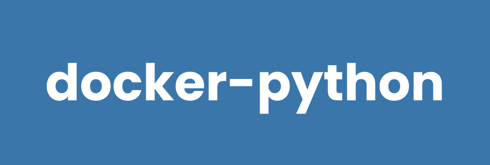

# docker-python



[](https://github.com/ragedunicorn/docker-python/actions/workflows/docker_release.yml)
[](https://github.com/ragedunicorn/docker-python/actions/workflows/test.yml)


> Docker Alpine image with Python and pip.


## Overview

This Docker image provides a minimal Python installation built on Alpine Linux. It ships a pinned, standalone CPython build ([python-build-standalone](https://github.com/astral-sh/python-build-standalone)) rather than Alpine's `python3` package, so the Python version is fixed independently of the Alpine release.

## Features

- **Small footprint**: compact runtime image using Alpine Linux
- **Pinned CPython**: standalone CPython at the version pinned in the `Dockerfile` (see the [releases](https://github.com/RagedUnicorn/docker-python/releases))
- **Minimal installation**: Only Python and pip included
- **Non-root user**: Enhanced security with dedicated python user
- **Volume mounting**: Easy code and data access through `/app`

## Quick Start

```bash
# Pull the image
docker pull ragedunicorn/python:latest

# Run Python interactively
docker run -it --rm ragedunicorn/python:latest
```

To run a script from the current directory:

```bash
docker run --rm -v $(pwd):/app ragedunicorn/python:latest script.py
```

On Windows, use the PowerShell form:

```powershell
docker run --rm -v "${PWD}:/app" ragedunicorn/python:latest script.py
```

Write `${PWD}` **with braces** and keep the colon inside the quotes - without
braces PowerShell parses `$PWD:` as a scope-qualified variable (as in
`$env:PATH`) and rejects the argument. See the
[Windows (PowerShell) notes](#windows-powershell-notes) for details.

For development and building from source, see [DEVELOPMENT.md](DEVELOPMENT.md).

## Usage

The container uses Python as the entrypoint, so any Python parameters can be passed directly to the `docker run` command.

### Basic Usage

```bash
# Using latest version
docker run -v $(pwd):/app ragedunicorn/python:latest [python-options]

# Using specific Python version (latest Alpine build)
docker run -v $(pwd):/app ragedunicorn/python:<python-major> [python-options]

# Using exact version combination
docker run -v $(pwd):/app ragedunicorn/python:<python-major>-alpine<alpine-version>-<build> [python-options]
```

PowerShell:

```powershell
# Using latest version
docker run -v "${PWD}:/app" ragedunicorn/python:latest [python-options]

# Using specific Python version (latest Alpine build)
docker run -v "${PWD}:/app" ragedunicorn/python:<python-major> [python-options]

# Using exact version combination
docker run -v "${PWD}:/app" ragedunicorn/python:<python-major>-alpine<alpine-version>-<build> [python-options]
```

Available tags are listed on [Docker Hub](https://hub.docker.com/r/ragedunicorn/python/tags) and in the
[GitHub releases](https://github.com/RagedUnicorn/docker-python/releases).

### Examples

#### Run Python Script
```bash
docker run -v $(pwd):/app ragedunicorn/python:latest script.py
```

PowerShell:

```powershell
docker run -v "${PWD}:/app" ragedunicorn/python:latest script.py
```

#### Interactive Python Shell
```bash
docker run -it --rm ragedunicorn/python:latest
```

#### Execute Python Code
```bash
docker run --rm ragedunicorn/python:latest -c "print('Hello, World!')"
```

#### Install Package and Run
```bash
docker run --rm -v $(pwd):/app --entrypoint /bin/sh ragedunicorn/python:latest -c "pip install requests && python script.py"
```

PowerShell:

```powershell
docker run --rm -v "${PWD}:/app" --entrypoint /bin/sh ragedunicorn/python:latest -c 'pip install requests && python script.py'
```

#### Check Python Version
```bash
docker run --rm ragedunicorn/python:latest --version
```

#### Run Tests
```bash
docker run --rm -v $(pwd):/app --entrypoint /bin/sh ragedunicorn/python:latest -c "pip install pytest && python -m pytest"
```

PowerShell:

```powershell
docker run --rm -v "${PWD}:/app" --entrypoint /bin/sh ragedunicorn/python:latest -c 'pip install pytest && python -m pytest'
```

The interactive shell, `-c` code and `--version` examples above take no mount
and run unchanged in PowerShell.

### Windows (PowerShell) notes

The PowerShell variants above differ from the bash ones in two ways: the
mount is written `-v "${PWD}:/app"` instead of `-v $(pwd):/app`, and the
`sh -c` command is wrapped in single quotes.

The mount spelling matters:

- Pasting the bash form into PowerShell breaks: an argument that starts with
  `$(pwd)` ends after the subexpression, so `$(pwd):/app` reaches Docker as
  two arguments (`C:\path` and `:/app`).
- `"$PWD:/app"` without braces is a parse error: PowerShell reads a colon
  after a variable as a scope qualifier (as in `$env:PATH`), and `/` is not a
  valid variable-name character.
- `"${PWD}:/app"` works: the braces end the variable name at `PWD`, the colon
  stays literal, and Docker splits the resulting `C:\path:/app` on the second
  colon because it recognises the `C:` drive prefix.

The single quotes around the `sh -c` command keep it as one literal argument
to the container's `sh`, so `&&` (and `;`) run inside the container and
nothing in the string is expanded by PowerShell.

To check what the container actually sees under `/app`, run a look-inside
command:

```powershell
docker run --rm -v "${PWD}:/app" --entrypoint /bin/sh ragedunicorn/python:latest -c 'pwd; ls -la /app'
```

Unquoted, PowerShell would treat `;` as its own statement separator and run
`ls -la /app` on the host.

For more complex invocations where PowerShell keeps mangling arguments, the
[stop-parsing token `--%`](https://learn.microsoft.com/en-us/powershell/module/microsoft.powershell.core/about/about_parsing#the-stop-parsing-token)
is an escape hatch: PowerShell passes everything after it verbatim. Nothing
after `--%` is expanded - including `${PWD}` - so it cannot be combined with
the mount examples above; none of the examples in this README need it.

## Docker Compose Usage

This repository includes Docker Compose configurations for easier usage and common Python development workflows.

### Basic Setup

1. Create an `app` directory:
```bash
mkdir -p app
```

2. Place your Python files in `app/`

3. Run Python using docker compose:
```bash
docker compose run --rm python script.py
```

### Example Configuration

The `examples/` directory contains a hello-world example:

#### Hello World Example (`examples/docker-compose.yml`)
```bash
# Run the hello world example
cd examples && docker compose run --rm hello-world
```

### Environment Variables

The compose configuration supports:

- `PYTHON_VERSION`: Specify Python image version (default: latest)
- `PYTHONUNBUFFERED`: Unbuffered output (set to 1)
- `TERM`: Terminal type for colored output

### Tips

1. **Custom Commands**: Override the default command:
   ```bash
   docker compose run --rm python -c "import sys; print(sys.version)"
   ```

2. **Development Mode**: Use the development compose file for building locally:
   ```bash
   docker compose -f docker-compose.dev.yml build
   docker compose -f docker-compose.dev.yml run --rm --entrypoint python python-dev script.py
   ```

3. **Persistent Settings**: The repository includes a `.env` file with default settings:
   ```env
   PYTHON_VERSION=latest
   ```

## Building Custom Images

To create a custom image with your required packages:

```dockerfile
FROM ragedunicorn/python:latest

# Install Python packages
USER root
RUN pip install requests numpy pandas
USER python

# Copy your application
WORKDIR /app
COPY . .

CMD ["python", "app.py"]
```

## Versioning

This project uses semantic versioning that matches the Docker image contents:

**Format:** `{python_major_version}-alpine{alpine_version}-{build_number}`

Examples (`X` is the Python major version, `A.B.C` the Alpine version):
- `X-alpineA.B.C-1` - Python X on Alpine A.B.C, build 1
- `X` - Most recent build of Python X
- `latest` - Most recent stable release

The current tags are listed on [Docker Hub](https://hub.docker.com/r/ragedunicorn/python/tags).

For detailed release process and versioning guidelines, see [RELEASE.md](RELEASE.md).

## Image Verification

Released images are signed with [cosign](https://docs.sigstore.dev/) keyless signing and carry SBOM and provenance attestations.

Verification requires cosign v3 or later: the release workflow signs with cosign v3, whose signatures cosign v2 does
not find (it reports `no signatures found`).

```bash
# Verify the signature (works for both ghcr.io/ragedunicorn/docker-python and ragedunicorn/python)
cosign verify ragedunicorn/python:latest \
  --certificate-identity-regexp '^https://github.com/RagedUnicorn/docker-python/\.github/workflows/docker_release\.yml@refs/tags/v' \
  --certificate-oidc-issuer https://token.actions.githubusercontent.com

# Inspect the SBOM and provenance attestations
docker buildx imagetools inspect ragedunicorn/python:latest --format '{{ json .SBOM }}'
docker buildx imagetools inspect ragedunicorn/python:latest --format '{{ json .Provenance }}'
```

## Automated Dependency Updates

This project uses [Renovate](https://docs.renovatebot.com/) to automatically check for updates to:
- Alpine Linux base image version (all major, minor, and patch updates)
- The pinned CPython version and the python-build-standalone release it is fetched from

Renovate runs weekly (every Monday) and creates pull requests when updates are available. Every Alpine reference is kept in sync from a single update: the `FROM` line, the `org.opencontainers.image.base.name` OCI label, and the Alpine version asserted in `test/python_metadata_test.yml` are grouped into one pull request. The CPython version and its python-build-standalone release are likewise grouped together.

## Documentation

- [Development Guide](DEVELOPMENT.md) - Building, debugging, and contributing
- [Testing Guide](TEST.md) - Running and writing tests
- [Release Process](RELEASE.md) - Creating releases and versioning

## Links

- [Python Documentation](https://docs.python.org/)
- [Alpine Linux](https://www.alpinelinux.org/)

# License

MIT License

Copyright (c) 2025 Michael Wiesendanger

Permission is hereby granted, free of charge, to any person obtaining a copy
of this software and associated documentation files (the "Software"), to deal
in the Software without restriction, including without limitation the rights
to use, copy, modify, merge, publish, distribute, sublicense, and/or sell
copies of the Software, and to permit persons to whom the Software is
furnished to do so, subject to the following conditions:

The above copyright notice and this permission notice shall be included in all
copies or substantial portions of the Software.

THE SOFTWARE IS PROVIDED "AS IS", WITHOUT WARRANTY OF ANY KIND, EXPRESS OR
IMPLIED, INCLUDING BUT NOT LIMITED TO THE WARRANTIES OF MERCHANTABILITY,
FITNESS FOR A PARTICULAR PURPOSE AND NONINFRINGEMENT. IN NO EVENT SHALL THE
AUTHORS OR COPYRIGHT HOLDERS BE LIABLE FOR ANY CLAIM, DAMAGES OR OTHER
LIABILITY, WHETHER IN AN ACTION OF CONTRACT, TORT OR OTHERWISE, ARISING FROM,
OUT OF OR IN CONNECTION WITH THE SOFTWARE OR THE USE OR OTHER DEALINGS IN THE
SOFTWARE.
